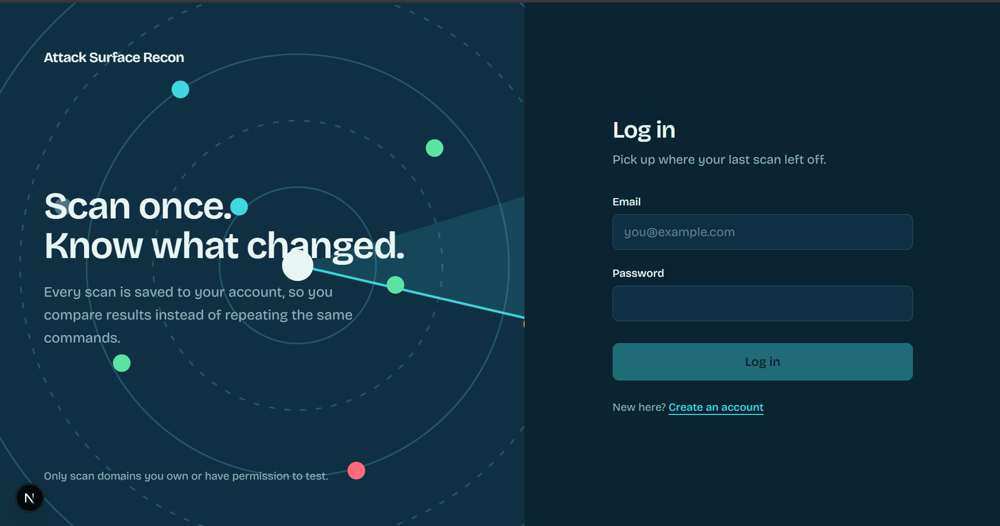
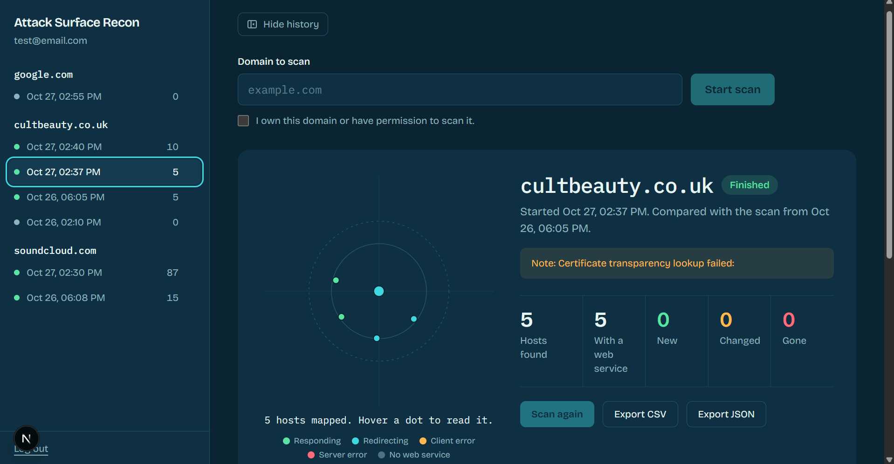
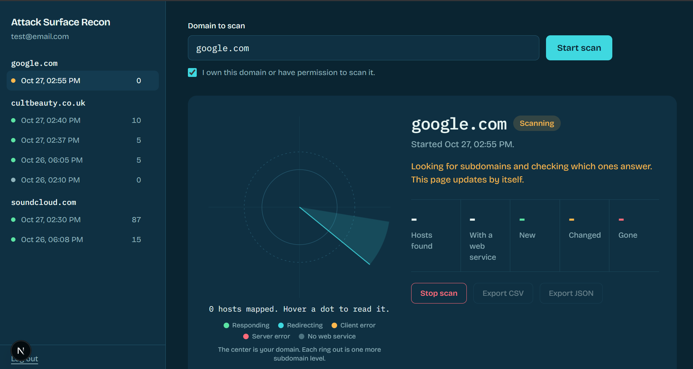
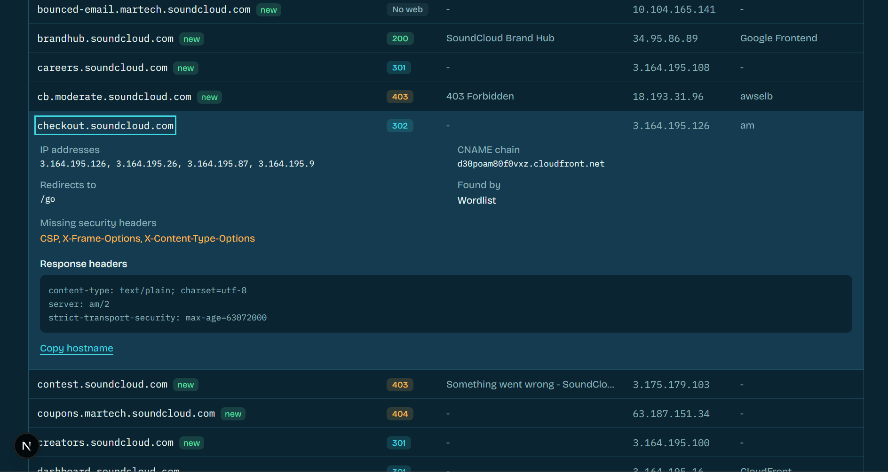
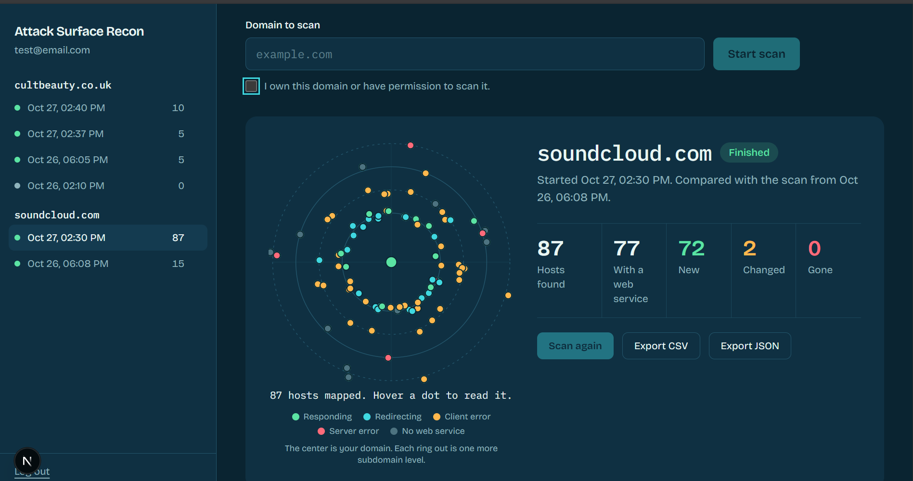
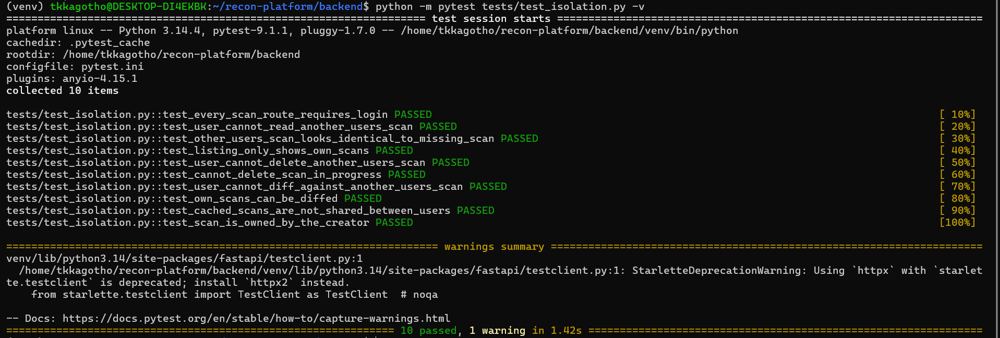
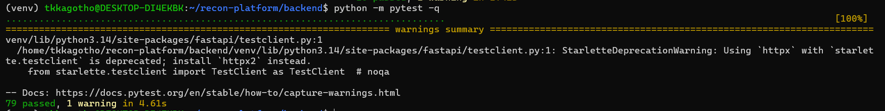

# Recon Platform

A web platform that finds the subdomains of a domain, checks which ones answer on the web, saves every scan to your account, and shows you what changed since the last one. The discovery and probing engine is written from scratch in Python. No external recon tools are required.

**Use only on domains you own or are explicitly authorized to test.**

## Demo video

[**Recon Platform Demo Video**](docs/video/demo.mp4)

## Screenshots

### 1. Login and register


### 2. Dashboard


### 3. Scan in progress


### 4. Hosts table with a row expanded


### 5. Changes between two scans


### 6. Data isolation tests


### 7. Full test suite



## Features

- **Own discovery engine:** certificate transparency lookup (crt.sh, with Cert Spotter as fallback), wordlist DNS brute force, and wildcard DNS detection so false positives are filtered out.
- **Own HTTP prober:** status code, page title, key headers, redirect target and a basic technology hint for each live host.
- **Scan history and comparison:** every scan is stored, and each scan is automatically compared with the previous one of the same domain (added, gone, changed).
- **Accounts and isolation:** register and log in, and see only your own scans.
- **Background scans:** jobs run through a Redis and Celery queue, can be stopped at any time, and the UI never blocks.
- **Export:** download the current view as CSV or JSON.

## Architecture

```
Next.js UI  ->  FastAPI  ->  Redis queue  ->  Celery worker  ->  Engine  ->  SQLite
                                                                   |
                                          discover -> resolve -> filter wildcards -> probe
```

The engine lives in `backend/app/engine/`

## Security design

- Passwords are hashed with scrypt and a unique salt. Sessions are stored on the server and expire after 12 hours. Logout invalidates the token.
- Every scan query is filtered by owner. A scan that belongs to someone else returns the same 404 as one that does not exist.
- Login errors are generic, so they do not reveal which emails are registered.
- CSV exports neutralize cells that start with `=`, `+`, `-` or `@`.
- The interface asks users to confirm they have permission to scan a domain before starting.

## Requirements

Python 3.11+, Node.js 20+, Redis, Celery

## Setup

```bash
# Backend
cd backend
python3 -m venv venv && source venv/bin/activate
pip install -r requirements.txt

# Frontend
cd ../frontend && npm install
```

## Run (four terminals)

```bash
sudo service redis-server start                                   # 1. Redis
cd backend && source venv/bin/activate
celery -A app.celery_app worker --loglevel=info                   # 2. Worker
cd backend && source venv/bin/activate
uvicorn app.main:app --reload                                     # 3. API (port 8000)
cd frontend && npm run dev                                        # 4. UI (port 3000)
```

Open http://localhost:3000, create an account, enter a domain you own, tick the permission box and start a scan. API docs are at http://localhost:8000/docs.

Restart the worker after changing backend code, since it does not reload by itself. The SQLite database (`backend/recon.db`) is created automatically. Delete it to reset all data.

## Tests

```bash
cd backend
python -m pytest -q
```

The suite covers the discovery, resolver, prober, pipeline and diff logic, authentication, scan cancellation, and per-user data isolation.

## Known limitations

- The login token is kept in browser storage. An httpOnly cookie would be more secure for production.
- The permission checkbox is enforced in the interface only, not by the server.
- Certificate transparency sources are public services and can be slow, rate limited or unavailable. A failed source shows as a warning on the scan instead of failing it.

## Project structure

- `backend/app/engine/`: discovery, resolver, prober, pipeline, diff
- `backend/app/`: API, authentication, worker tasks, models
- `backend/app/adapters/`: optional Subfinder and HTTPx wrappers for benchmarking
- `backend/tests/`: automated tests
- `frontend/app/`: Next.js interface
- `docs/`: design document, dev log, bug log, screenshots
