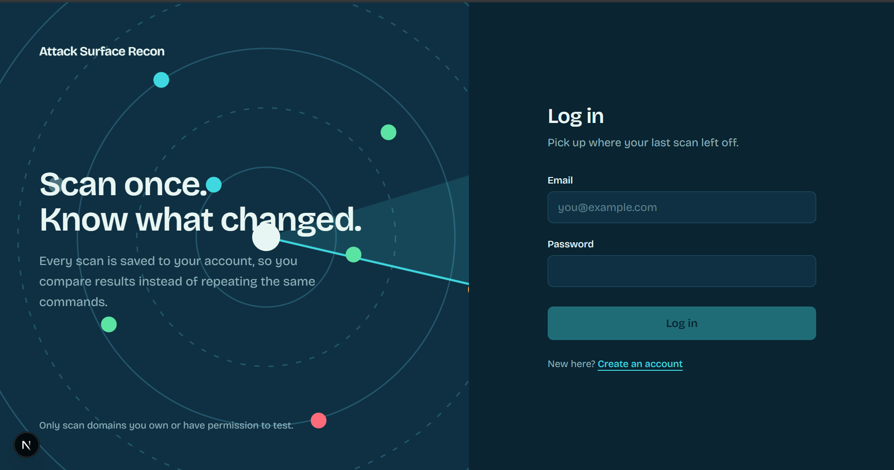
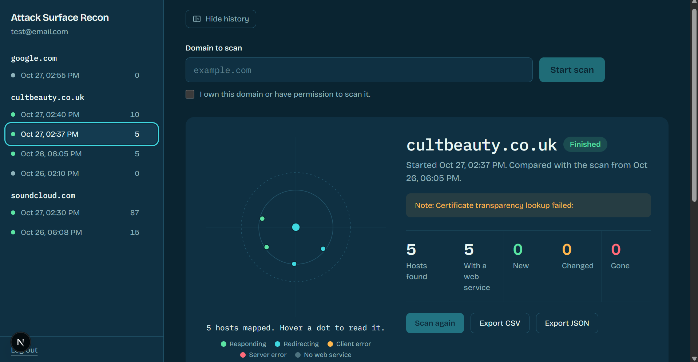
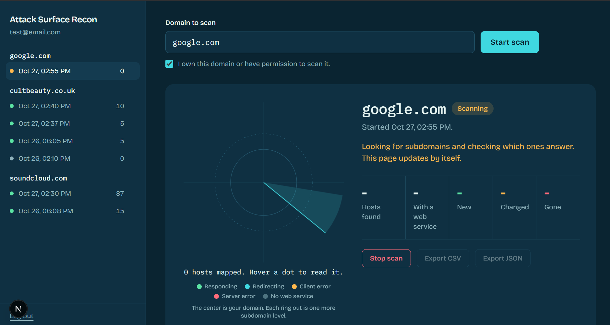
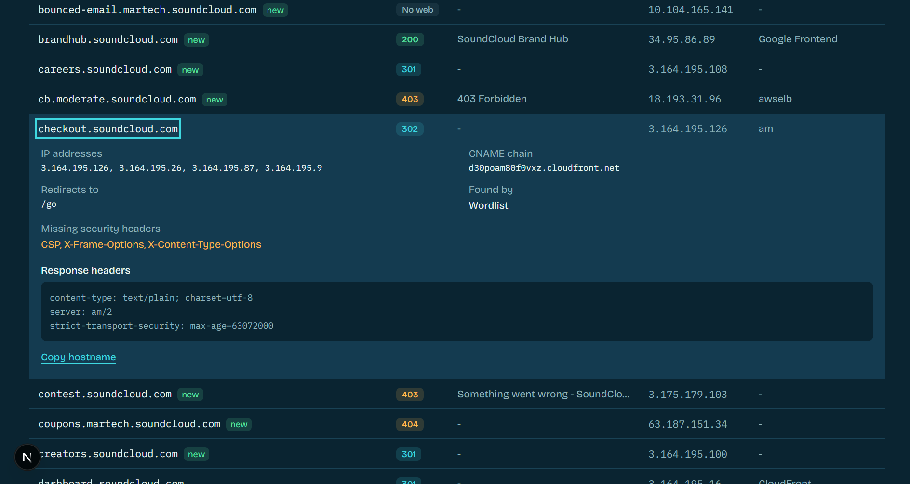
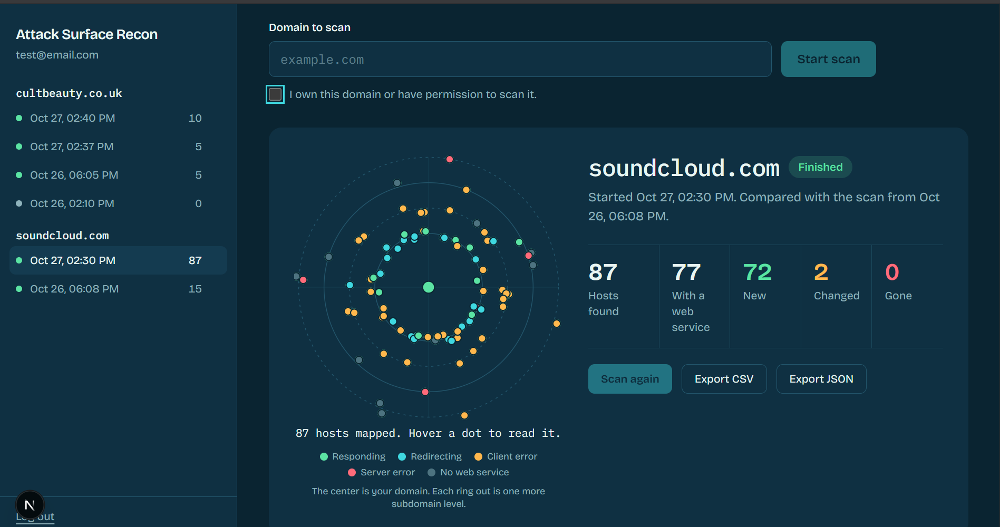
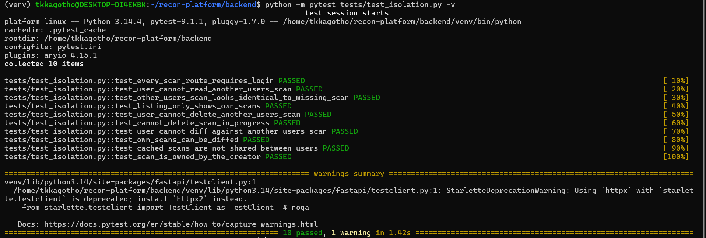
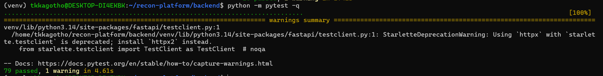

# Recon Platform

A web platform that finds the subdomains of a domain, checks which ones answer on the web, saves every scan to your account, and shows you what changed since the last one. The discovery and probing engine is written from scratch in Python. No external recon tools are required.

**Use only on domains you own or are explicitly authorized to test.**

## Demo video

[**Recon Platform Demo Video**](docs/video/demo.mp4)

## Screenshots

### 1. Login and register


### 2. Dashboard


### 3. Scan in progress


### 4. Hosts table with a row expanded


### 5. Changes between two scans


### 6. Data isolation tests


### 7. Full test suite



## Features

- **Own discovery engine:** certificate transparency lookup (crt.sh, with Cert Spotter as fallback), wordlist DNS brute force, and wildcard DNS detection so false positives are filtered out.
- **Own HTTP prober:** status code, page title, key headers, redirect target and a basic technology hint for each live host.
- **Scan history and comparison:** every scan is stored, and each scan is automatically compared with the previous one of the same domain (added, gone, changed).
- **Accounts and isolation:** register and log in, and see only your own scans.
- **Background scans:** jobs run through a Redis and Celery queue, can be stopped at any time, and the UI never blocks.
- **Export:** download the current view as CSV or JSON.

## Architecture

```
Next.js UI  ->  FastAPI  ->  Redis queue  ->  Celery worker  ->  Engine  ->  SQLite
                                                                   |
                                          discover -> resolve -> filter wildcards -> probe
```

The engine lives in `backend/app/engine/`

## Security design

- Passwords are hashed with scrypt and a unique salt. Sessions are stored on the server and expire after 12 hours. Logout invalidates the token.
- Every scan query is filtered by owner. A scan that belongs to someone else returns the same 404 as one that does not exist.
- Login errors are generic, so they do not reveal which emails are registered.
- CSV exports neutralize cells that start with `=`, `+`, `-` or `@`.
- The interface asks users to confirm they have permission to scan a domain before starting.

## Requirements

| Tool | Version | Check with |
|------|---------|------------|
| Python | 3.11 or newer | `python3 --version` |
| Node.js | 20 or newer | `node -v` |
| Redis | any recent version | `redis-server --version` |

Tested on Ubuntu under WSL2 (Windows). Native Linux works the same way. On macOS, replace the Redis commands with `brew install redis` and `brew services start redis`.

Install the system packages on Ubuntu/WSL:

```bash
sudo apt update
sudo apt install -y python3 python3-venv python3-pip redis-server
```

## Setup (one time)

```bash
# 1. Get the code
git clone https://github.com/tkvyy/recon-platform.git
cd recon-platform

# 2. Backend: create the virtual environment and install dependencies
cd backend
python3 -m venv venv
source venv/bin/activate
pip install -r requirements.txt
deactivate
cd ..

# 3. Frontend: install dependencies
cd frontend
npm install
cd ..
```

No configuration file is needed. The SQLite database (`backend/recon.db`) is created automatically on first run.

## Run

The platform has four parts that run at the same time, so open **four terminal windows**. Start them in this order.

**Terminal 1: Redis (job queue)**

```bash
sudo service redis-server start
redis-cli ping        # should print PONG
```

**Terminal 2: Worker (runs the scans)**

```bash
cd recon-platform/backend
source venv/bin/activate
celery -A app.celery_app worker --loglevel=info
```

**Terminal 3: API**

```bash
cd recon-platform/backend
source venv/bin/activate
uvicorn app.main:app --reload
```

**Terminal 4: Web interface**

```bash
cd recon-platform/frontend
npm run dev
```

Then open **http://localhost:3000**, create an account, enter a domain you own, tick the permission box and start a scan.

| Address | What it is |
|---------|------------|
| http://localhost:3000 | Web interface |
| http://localhost:8000/docs | Interactive API documentation |

To stop everything, press `Ctrl+C` in each terminal. To reset all data, stop the API and worker and delete `backend/recon.db`.

## Troubleshooting

| Problem | Likely cause and fix |
|---------|----------------------|
| A scan stays "queued" and never starts | The worker is not running. Start Terminal 2 and check that it prints "ready". |
| Error mentioning Redis or "connection refused" | Redis is not running. Run `sudo service redis-server start`, then `redis-cli ping`. |
| The page loads but login or scans fail | The API is not running. Start Terminal 3 and check http://localhost:8000/docs opens. |
| `command not found: celery` or `uvicorn` | The virtual environment is not active. Run `source venv/bin/activate` in that terminal first. |
| `Address already in use` | Another program is using port 3000 or 8000. Close it, or stop the old copy of the platform. |
| Backend changes do not take effect | The worker does not reload by itself. Stop it and start it again. |
| A scan shows a warning about a certificate source | The public lookup service (crt.sh or Cert Spotter) was slow or unavailable. The scan still completes with the other sources. |

## Tests

```bash
cd backend
source venv/bin/activate
python -m pytest -q
```


The suite covers the discovery, resolver, prober, pipeline and diff logic, authentication, scan cancellation, and per-user data isolation.

## Known limitations

- The login token is kept in browser storage. An httpOnly cookie would be more secure for production.
- The permission checkbox is enforced in the interface only, not by the server.
- Certificate transparency sources are public services and can be slow, rate limited or unavailable. A failed source shows as a warning on the scan instead of failing it.

## Project structure

- `backend/app/engine/`: discovery, resolver, prober, pipeline, diff
- `backend/app/`: API, authentication, worker tasks, models
- `backend/app/adapters/`: optional Subfinder and HTTPx wrappers for benchmarking
- `backend/tests/`: automated tests
- `frontend/app/`: Next.js interface
- `docs/`: design document, dev log, bug log, screenshots
